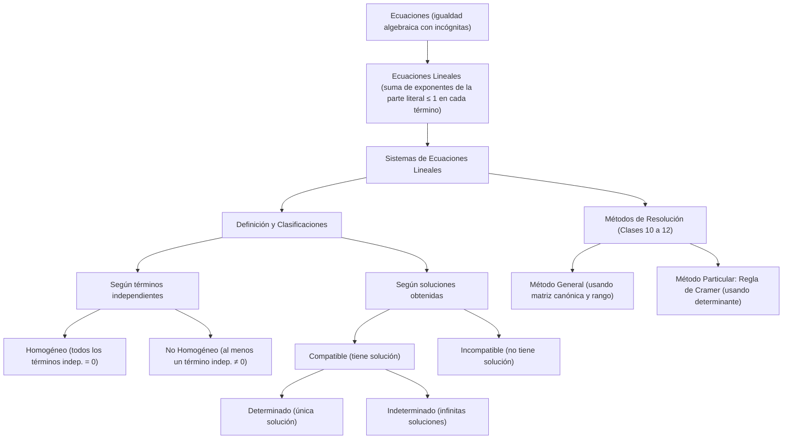

# Clase 9 — Sistemas de Ecuaciones

## 🗺️ Mapa de la clase

### Ubicación en la materia y estructura del recorrido
Esta clase inaugura la **Unidad 3: Sistemas de Ecuaciones**, aplicando las herramientas algebraicas construidas en la Unidad 2 (Matrices y Determinantes) a la modelización y resolución de problemas con múltiples condiciones e incógnitas simultáneas.

El recorrido teórico de la clase sigue este orden lógico:
1. **Introducción y Esquema de la Unidad (9.1):**
   - Motivación: por qué usar matrices y determinantes para resolver sistemas con varias ecuaciones e incógnitas.
   - Mapa general de la Unidad 3: de las **Ecuaciones** a los **Sistemas de Ecuaciones**, divididos en su **Definición** y sus **Métodos de resolución** (**Método General** usando matriz canónica y rango, y **Método Particular: Regla de Cramer** usando determinantes).
2. **Motivación histórica y matricial — Cuadrados Mágicos (9.2):**
   - Definición de **cuadrado mágico** y de **constante mágica** sobre una matriz cuadrada.
   - Casos clásicos: cuadrado mágico chino del río Amarillo (orden 3, constante mágica 15), aportes de Benjamin Franklin, el **Cuadrado Mágico de Durero** (orden 4, constante mágica 34) y el interrogante sobre el cuadrado mágico de orden 2.
3. **Ecuaciones y sus elementos fundamentales (9.3 y 9.4):**
   - Definición de **ecuación**, **parte literal** (la o las incógnitas), **raíces o soluciones**, y qué significa **resolver** una ecuación.
   - Definición de **parte literal de un término** (la letra junto a su exponente).
   - Distinción entre **ecuaciones lineales** (la suma de los exponentes de la parte literal es a lo sumo 1, en cada término) y **ecuaciones no lineales**.
4. **Sistemas de Ecuaciones Lineales (9.5):**
   - Cómo surge un sistema de ecuaciones cuando dos o más condiciones deben cumplirse simultáneamente.
   - **Reescritura / ordenamiento** de un sistema lineal: términos con incógnitas en el primer miembro y términos independientes en el segundo miembro.
   - Definición de **resolver un sistema de ecuaciones** y noción de **sistemas equivalentes**.
5. **Clasificaciones de los Sistemas de Ecuaciones Lineales (9.6 y 9.7):**
   - **Según sus términos independientes:**
     - **Sistema Homogéneo** (todos los términos independientes nulos).
     - **Sistema No Homogéneo** (por lo menos un término independiente distinto de cero).
   - **Según sus soluciones (de acuerdo a las soluciones obtenidas):**
     - **Sistema Compatible** (tiene solución):
       - **Compatible Determinado** (única solución).
       - **Compatible Indeterminado** (infinitas soluciones).
     - **Sistema Incompatible** (no tiene solución).
6. **Validación de resultados — Comprobación de soluciones (9.8):**
   - Procedimiento para verificar si un conjunto de valores es solución de una ecuación o de un sistema de ecuaciones mediante el reemplazo simultáneo en todas las ecuaciones, y qué permite concluir respecto de la compatibilidad del sistema.



### Objetivos de la clase (según la portada del material)
> 📖 **Textual del material:** "Al finalizar la clase los alumnos:
> • Buscar soluciones a problemas y validar su respuesta.
> • Clasificar los sistemas de ecuaciones de acuerdo a las soluciones obtenidas."

### Prerrequisitos (conexión con la Unidad 2)
Para dominar esta unidad es indispensable manejar con soltura los conceptos de la unidad anterior (**Matrices y Determinantes**):
- **Matriz y orden de una matriz** (filas, columnas, matriz cuadrada de orden n, diagonales principal y secundaria).
- **Operaciones elementales entre filas y matriz canónica equivalente** (base del método general que se desarrolla en la Clase 10).
- **Rango de una matriz** (número de filas no nulas de la matriz canónica equivalente).
- **Determinante de una matriz cuadrada** (base del método particular o Regla de Cramer que se verá en las clases siguientes).

---

## 9.1 Introducción y Esquema de la Unidad: Aplicación de Matrices y Determinantes

> 📖 **Textual del material:** "Hoy vamos a comenzar con nuevas aplicaciones de lo que aprendimos sobre las matrices. Veremos que nos pueden ser de gran utilidad en la resolución de sistemas de ecuaciones sobre todo cuando las ecuaciones son varias al igual que las incógnitas. No es que no se puedan resolver de otras formas, pero con las matrices es muchísimo más práctico.
> Muchos problemas técnicos y científicos involucran en su resolución sistemas que contienen un número elevado de ecuaciones y de incógnitas, por lo que estudiar dichos sistemas y los métodos adecuados de resolución, es fundamental para cualquier disciplina que utiliza a la matemática como una herramienta."

> 📖 **Textual del material:** "ESQUEMA DE UNIDAD
> En esta unidad veremos una aplicación de Matrices y Determinantes para la resolución de sistemas de ecuaciones.
> En primera instancia recordaremos que es una ecuación para posteriormente definir sistemas de ecuaciones.
> Luego estudiaremos un método de resolución general, en el cual se usan elementos de la unidad anterior como matriz canónica y rango; y un método particular: Regla de Cramer, utilizando de la unidad anterior, el cálculo de determinantes.
> Queda claro, entonces, la importancia que tiene en esta unidad el correcto manejo de los temas de la unidad anterior."

> 📖 **Textual del material:** "Ecuaciones → Sistemas de Ecuaciones → Definición | Métodos → General (Usando canónica) | Particular (Usando determinante)"

**🗣️ En palabras simples:**
En la escuela secundaria aprendimos a resolver sistemas pequeños (de 2 ecuaciones con 2 incógnitas) por sustitución o igualación. Pero cuando un problema técnico o científico tiene 3, 4 o 50 ecuaciones e incógnitas, esos métodos manuales se vuelven inmanejables. Por eso la Unidad 3 conecta los sistemas de ecuaciones con las **matrices** y los **determinantes**: nos da dos caminos sistemáticos para resolverlos:
1. Un **método general** (sirve para *cualquier* sistema lineal, tenga la forma que tenga), basado en llevar una matriz a su **matriz canónica** y analizar su **rango**.
2. Un **método particular** llamado **Regla de Cramer** (solo aplicable bajo ciertas condiciones particulares que se verán más adelante), basado en el cálculo de **determinantes**.

**🔍 Desglose de la jerga:**
- **"Método de resolución general (usando canónica)"**: se llama *general* porque no impone restricciones sobre la cantidad de ecuaciones ni de incógnitas; utiliza la reducción por filas a la **matriz canónica** y el concepto de **rango** vistos en la Unidad 2.
- **"Método particular: Regla de Cramer (usando determinante)"**: se llama *particular* porque solo puede aplicarse a un caso específico de sistemas (sistemas cuadrados cuya matriz de coeficientes tiene determinante distinto de cero, ya que los determinantes solo existen para matrices cuadradas).

**💡 Ejemplo:**
*(Del material, págs. 3–4)* Un problema con una sola condición desconocida (como calcular cuánto dinero tenía si gasté un tercio y me quedan 600 pesos) se modela con una única ecuación (`1/3 . x + 600 = x`). En cambio, un problema con tres empresarios A, B y C y múltiples condiciones simultáneas requiere un **sistema de ecuaciones** (`A + B + C = 12` y `2.A + 3.B = 4.C`), donde las herramientas matriciales mostrarán toda su potencia.

**🔗 Conexiones:**
- **Con las Clases 5 a 8 (Unidad 2):** retoma directamente matriz canónica, operaciones elementales de fila, rango de una matriz y determinantes.
- **Con las Clases 10, 11 y 12 (Unidad 3):** la Clase 9 presenta las definiciones de base y las clasificaciones; la Clase 10 desarrolla el método general (matriz ampliada, forma matricial, rango); y las clases siguientes abordan los distintos casos de solución y la Regla de Cramer.

**⚠️ Precisiones / errores comunes:**
- No confundir cuál herramienta de la Unidad 2 usa cada método: el **método general** usa **matriz canónica y rango**, mientras que el **método particular (Regla de Cramer)** usa **determinantes**. En el oral suelen preguntar esta distinción del esquema de la unidad.

**🎤 Cómo decirlo en el oral:**
> "En esta unidad aplicamos matrices y determinantes para resolver sistemas de ecuaciones lineales, especialmente cuando hay varias ecuaciones e incógnitas. El esquema de la unidad parte de recordar qué es una ecuación para luego definir sistemas de ecuaciones, clasificarlos y estudiarlos mediante dos métodos de resolución: un **método general**, que utiliza la **matriz canónica** y el **rango**, y un **método particular**, la **Regla de Cramer**, que utiliza el cálculo de **determinantes**."

---

## 9.2 Cuadrado Mágico y Constante Mágica

> 📖 **Textual del material:** "El primer registro de un Cuadrado Mágico aparece en la historia alrededor del tercer milenio AC. Cuenta la leyenda que el emperador de China estaba en la orilla del río Amarillo cuando una tortuga salió de las aguas. Sobre su caparazón, la tortuga llevaba impresos extraños símbolos, que el emperador se encargó de descifrar. Eral los números del 1 al 9 dispuestos armoniosamente en forma de cuadrado: al sumar los tres números de cada fila, de cada columna o de cada diagonal e resultado siempre era quince.
> A estos cuadrados se le atribuyeron inicialmente propiedades religiosas y mágicas. Con el paso de los siglos, atrajeron la atención de los matemáticos que se dedicaron al estudio, ya no de sus propiedades mágicas, sino de sus propiedades matemáticas, que son muchas.
> Cabe mencionar que Benjamin Franklin (norteamericano, 1706-1790) dedicó varias horas de su vida a estudiar y crear muy diversos cuadrados mágicos.
> Los cuadrados mágicos son distribuciones de números que se disponen en una matriz cuadrada de forma que la suma de cualquiera de las filas, de cualquiera de las columnas y de las dos diagonales da siempre el mismo resultado. Al número resultante se le denomina “constante mágica”. Usualmente se utilizan números consecutivos, comenzando en el 1, para completar la matriz. Un ejemplo muy conocido es el Cuadrado Mágico de Durero (alemán 1471-1528). Es de orden 4 y la constante mágica es 34.
> Te propongo que construyas, si es posible un cuadrado mágico de orden 2. Si no lo consigues, no te desesperes, al final de la unidad podremos explicar la respuesta."

**🗣️ En palabras simples:**
Un **cuadrado mágico** es una **matriz cuadrada** (misma cantidad de filas que de columnas, es decir, de orden n × n) rellena con números (habitualmente los naturales consecutivos desde 1 hasta n²) de tal manera que si sumás todos los números de cualquier fila, de cualquier columna o de cualquiera de las dos diagonales (la principal y la secundaria), siempre obtenés exactamente el mismo número. Ese resultado fijo que se repite en todas las sumas se llama **constante mágica**.

**🔍 Desglose de la jerga:**
- **"Distribuciones de números que se disponen en una matriz cuadrada"**: los elementos se ubican en un arreglo de n filas y n columnas (orden n). Tiene que ser cuadrada para que tenga la misma cantidad de elementos por fila y columna y para que existan sus dos diagonales.
- **"La suma de cualquiera de las filas, de cualquiera de las columnas y de las dos diagonales da siempre el mismo resultado"**: impone 2n + 2 condiciones de igualdad simultáneas (n sumas de filas + n sumas de columnas + 2 sumas diagonales).
- **"Constante mágica"**: nombre técnico que recibe ese resultado único que arrojan todas las filas, todas las columnas y ambas diagonales.
- **"Usualmente se utilizan números consecutivos, comenzando en el 1, para completar la matriz"**: en un cuadrado mágico de orden n se suelen usar los números del 1 al n² sin repetir (por ejemplo, del 1 al 9 si es de orden 3, o del 1 al 16 si es de orden 4).

**💡 Ejemplo:**
El material presenta dos ejemplos históricos fundamentales:

1. **Cuadrado Mágico del río Amarillo (orden 3, números del 1 al 9, constante mágica = 15):**
   ```
   4   9   2
   3   5   7
   8   1   6
   ```
   - Filas: `4 + 9 + 2 = 15`, `3 + 5 + 7 = 15`, `8 + 1 + 6 = 15`.
   - Columnas: `4 + 3 + 8 = 15`, `9 + 5 + 1 = 15`, `2 + 7 + 6 = 15`.
   - Diagonales: `4 + 5 + 6 = 15` y `2 + 5 + 8 = 15`.

2. **Cuadrado Mágico de Durero (orden 4, números del 1 al 16, constante mágica = 34):**
   ```
   16    3    2   13
    5   10   11    8
    9    6    7   12
    4   15   14    1
   ```
   - Cualquier fila (ej. `16 + 3 + 2 + 13 = 34`), columna (ej. `16 + 5 + 9 + 4 = 34`) o diagonal (`16 + 10 + 7 + 1 = 34` y `13 + 11 + 6 + 4 = 34`) suma **34**.

**🔗 Conexiones:**
- **¿Por qué aparece un cuadrado mágico en la clase de Sistemas de Ecuaciones?** *(Contexto adicional para comprender el puente pedagógico del material)*: Porque armar un cuadrado mágico equivale a plantear un **sistema de ecuaciones lineales** donde las incógnitas son las casillas de la matriz y cada condición de fila, columna o diagonal es una ecuación lineal. En particular, intentar armar un cuadrado mágico de **orden 2** con los números 1, 2, 3 y 4 lleva a un sistema donde todas las casillas deberían ser iguales entre sí, lo cual contradice usar números distintos consecutivos (es imposible construirlo con números distintos).

**⚠️ Precisiones / errores comunes:**
- No olvidar mencionar **"las dos diagonales"** al definir cuadrado mágico: no basta con que sumen lo mismo las filas y las columnas, también deben sumar la constante mágica tanto la diagonal principal como la diagonal secundaria.

**🎤 Cómo decirlo en el oral:**
> "Los cuadrados mágicos son distribuciones de números que se disponen en una matriz cuadrada de forma que la suma de cualquiera de las filas, de cualquiera de las columnas y de las dos diagonales da siempre el mismo resultado. A ese número resultante se lo denomina **constante mágica**, y usualmente se completan con números consecutivos comenzando en el 1."

---

## 9.3 Ecuación, Incógnitas (Parte Literal), Raíces o Soluciones, y Resolver una Ecuación

> 📖 **Textual del material:** "ECUACIÓN
> Una ecuación es una igualdad entre dos expresiones algebraicas que sólo se satisface para determinados valores de la parte literal. (la parte literal sería la o las incógnitas) Estos valores que satisfacen la igualdad se denominan **raíces o soluciones** de la ecuación.
> Por ejemplo para nuestra primera ecuación 1/3. x + 600 = x
> Su raíz o solución sería: 900.
> Dada una ecuación, el objetivo es RESOLVERLA, esto es encontrar, si tiene, sus raíces o soluciones."

**🗣️ En palabras simples:**
Una **ecuación** es una afirmación de igualdad entre dos fórmulas con letras (incógnitas) que **no** es verdadera para cualquier número que pongas, sino únicamente para ciertos valores específicos. Esos valores específicos que hacen que la cuenta de la izquierda dé exactamente igual que la de la derecha se llaman **raíces o soluciones** de la ecuación. Y **resolver** una ecuación no es otra cosa que hallar esas raíces o soluciones (en caso de que existan).

**🔍 Desglose de la jerga:**
- **"Igualdad entre dos expresiones algebraicas"**: tiene un signo igual (`=`) que separa un **primer miembro** (izquierda) y un **segundo miembro** (derecha), donde aparecen combinaciones de números y letras vinculados por operaciones algebraicas.
- **"Que sólo se satisface para determinados valores de la parte literal"**: esta frase es clave en la definición del profesor. Distingue una *ecuación* de una *identidad* (una identidad como `x + x = 2x` se cumple para cualquier valor de `x`, mientras que una ecuación solo se satisface para determinados valores).
- **"(la parte literal sería la o las incógnitas)"**: aclara que en el contexto de una ecuación las letras representan cantidades desconocidas (incógnitas).
- **"Raíces o soluciones de la ecuación"**: ambos términos son sinónimos en el material; designan a los valores numéricos de las incógnitas que, al ser reemplazados en la ecuación, hacen verdadera la igualdad.
- **"Dada una ecuación, el objetivo es RESOLVERLA, esto es encontrar, si tiene, sus raíces o soluciones"**: observa la salvedad **"si tiene"**, porque una ecuación podría no tener solución.

**💡 Ejemplo:**
1. *(Del material, Ejemplo Nº1, págs. 3 y 5)*:
   - Problema: *"¿Cuál es la cantidad de dinero que tenía si gasté un tercio y aún me quedan 600 pesos?"*
   - Llamando `x` a la cantidad de dinero total que tenía: `Lo que gasté + lo que me queda = Lo que tenía`, es decir:
     `1/3 . x + 600 = x`
   - Su **raíz o solución** es `900`, porque `1/3 . 900 + 600 = 300 + 600 = 900` (satisface la igualdad).
2. *(Del material, Ejemplo Nº2, págs. 3 y 4)*:
   - Problema: *"La resta de las edades de dos hermanos es 5 y la suma es 49. ¿Qué edades tienen?"*
   - Si el hermano 1 tiene edad `A`, el otro tiene `B = A + 5`. Como la suma es 49:
     `A + (A + 5) = 49` ⇒ `2 . A + 5 = 49` ⇒ `2.A = 49 - 5` ⇒ `2A = 44` ⇒ `A = 44 : 2` ⇒ `A = 22`.
   - Entonces el hermano 1 tiene `22` y el hermano 2 tiene `22 + 5 = 27`. Comprobación: `22 + 27 = 49` ("la solución obtenida verifica la ecuación planteada por el problema, y la respuesta es coherente a lo que se planteó").

**🔗 Conexiones:**
- Es el concepto base del cual se desprende el concepto de **sistema de ecuaciones** (cuando tenemos varias ecuaciones que deben cumplirse a la vez).

**⚠️ Precisiones / errores comunes:**
- **Error común en el oral:** decir solamente "una ecuación es una igualdad con una incógnita". Al profesor le falta escuchar:
  1. Que es una igualdad **entre dos expresiones algebraicas**;
  2. Que **sólo se satisface para determinados valores de la parte literal** (que puede ser **la o las incógnitas**, ¡una ecuación puede tener más de una incógnita, como `A + B + C = 12`!);
  3. Que dichos valores se denominan **raíces o soluciones**.
- Al definir qué es **resolver** una ecuación, no olvidar agregar **"si tiene"** ("encontrar, si tiene, sus raíces o soluciones").

**🎤 Cómo decirlo en el oral:**
> "Una ecuación es una igualdad entre dos expresiones algebraicas que sólo se satisface para determinados valores de la parte literal, donde la parte literal es la o las incógnitas. Esos valores que satisfacen la igualdad se denominan **raíces o soluciones** de la ecuación. Dada una ecuación, el objetivo es **resolverla**, esto es encontrar, si tiene, sus raíces o soluciones."

---

## 9.4 Parte Literal de un Término y Ecuaciones Lineales (vs. No Lineales)

> 📖 **Textual del material:** "Como ya se dijo, de todos los tipos de ecuaciones sólo estudiaremos las lineales. **Ecuaciones lineales** son aquellas en las que la suma de los exponentes de la parte literal* es a lo sumo 1, en cada término.
> Las ecuaciones que hemos trabajado son lineales. Un ejemplo de ecuaciones no lineales serían por ejemplo: x² + 4x = -2 ó 3x⁴ + 2x³ -5x = 2x en las cuales los exponentes de cada una de las partes literales es mayor a 1."

> 📖 **Textual del material:** "La parte literal de un término es la letra junto a su exponente. Por ejemplo, si se tiene 3.a⁵ – 3.b², la parte literal del primer término es a⁵ y la del segundo término es b²."

> 📖 **Textual del material:** "Este es un sistema de ecuaciones lineales (ya que cada ecuación tiene cada uno de sus términos de grado 1)."

**🗣️ En palabras simples:**
Cada "pedacito" de una ecuación separado por signos `+` o `-` es un **término**. En cada término hay un número que multiplica (el coeficiente) y una parte con letras y sus exponentes, llamada **parte literal** (por ejemplo, en `3.a⁵`, el número es `3` y la parte literal es `a⁵`).
Una ecuación se llama **lineal** cuando, mirando término por término, **la suma de los exponentes de la parte literal es como máximo 1 en cada término** (es decir, puede ser 1 si tiene una incógnita elevada a la 1, o 0 si es un término independiente sin letras). No pueden aparecer incógnitas al cuadrado (`x²`), al cubo (`x³`), ni dos incógnitas multiplicándose entre sí en el mismo término (`x.y`).

**🔍 Desglose de la jerga:**
- **"La parte literal de un término es la letra junto a su exponente"**: incluye tanto la variable (letra) como el exponente al que está elevada. El número que la multiplica (coeficiente) **no** forma parte de la parte literal.
- **"La suma de los exponentes de la parte literal es a lo sumo 1, en cada término"**:
  - **"La suma de los exponentes"**: *(Explicación adicional para entender la exactitud de la definición)* ¿Por qué dice "la suma de los exponentes" y no simplemente "el exponente"? Porque si un término tuviera dos letras multiplicadas, como `2.x¹.y¹`, cada letra individual tendría exponente 1, pero **la suma de los exponentes de la parte literal en ese término** sería `1 + 1 = 2` (> 1), por lo que **no** sería lineal.
  - **"Es a lo sumo 1"**: significa menor o igual a 1 (`≤ 1`). En los términos con una incógnita (como `4x`, que es `4x¹`) la suma es `1`; en los términos independientes numéricos (como `600` o `-2`, donde no hay letra, equivalente a exponente `0`) es `0`. En ambos casos es "a lo sumo 1".
  - **"En cada término"**: equivale a un cuantificador universal ("para todo término de la ecuación"). Basta con que **un solo término** tenga suma de exponentes mayor a 1 para que toda la ecuación deje de ser lineal.

**💡 Ejemplo:**
- **Ejemplo de parte literal (del material, pág. 5):**
  En la expresión `3.a⁵ – 3.b²`:
  - La parte literal del primer término (`3.a⁵`) es `a⁵`.
  - La parte literal del segundo término (`– 3.b²`) es `b²`.
- **Ejemplos de ecuaciones lineales (del material, págs. 3–6):**
  - `1/3 . x + 600 = x` (una incógnita, grado 1).
  - `A + B + C = 12` y `2.A + 3.B = 4.C` (tres incógnitas, cada término con incógnita tiene exponente 1).
- **Ejemplos de ecuaciones NO lineales (del material, pág. 5):**
  - `x² + 4x = -2` (no es lineal porque en el primer término la parte literal es `x²`, cuyo exponente es 2 > 1).
  - `3x⁴ + 2x³ - 5x = 2x` (no es lineal porque aparecen partes literales `x⁴` y `x³` con exponentes mayores a 1).

**🔗 Conexiones:**
- Esta condición de linealidad es la que permite escribir un sistema en **forma matricial** (`A . X = B`) en la Clase 10: como cada término tiene a lo sumo una incógnita elevada a la 1, cada ecuación es una combinación lineal de las incógnitas.

**⚠️ Precisiones / errores comunes:**
- **Cuidado con definir parte literal sin el exponente:** el material recalca explícitamente en un recuadro: *"La parte literal de un término es la letra **junto a su exponente**"*. En `3.a⁵`, la parte literal no es `a`, sino `a⁵`.
- **Cuidado con decir "el exponente es 1" en vez de "a lo sumo 1":** dice **"a lo sumo 1"** porque los términos independientes no tienen parte literal (grado 0), y `0 ≤ 1`.

**🎤 Cómo decirlo en el oral:**
> "La parte literal de un término es la letra junto a su exponente; por ejemplo, en `3.a⁵ - 3.b²`, la parte literal del primer término es `a⁵` y la del segundo es `b²`. Y las **ecuaciones lineales** son aquellas en las que la suma de los exponentes de la parte literal es a lo sumo 1, en cada término."

---

## 9.5 Sistema de Ecuaciones Lineales, Reescritura (Ordenamiento) y Resolución de un Sistema

> 📖 **Textual del material:** "Ejemplo Nº3: Tres empresarios aportan a una sociedad 12 millones de pesos entre los tres. El doble de lo que aporta el primero más el triple de lo que aporta el segundo es igual al cuádruple de lo que aporta el tercero. ¿Cuáles son todas las posibles cantidades que pueden aportar cada uno?
> Analicemos la situación y coloquemos nombre a los empresarios… Empresario A, Empresario B y Empresario C
> • Una de las condiciones es que los tres empresarios aportan a la sociedad 12 millones de pesos… Eso se puede simbolizar de la siguiente manera: A + B +C = 12
> • Por otro lado, las segunda parte del problema: El doble de lo que aporta el primero: 2.A más el triple de lo que aporta el segundo: 3.B es igual al cuádruple de lo que aporta el tercero. 4.C, es decir: 2.A + 3.B = 4.C
> Pasando en limpio las condiciones serían:
> A + B +C = 12
> 2.A + 3.B = 4.C
> Y como las dos condiciones se deben cumplir simultáneamente, podríamos agruparlas así:
> { A + B +C = 12
> { 2.A + 3B = 4.C
> Estamos frente a un sistema de ecuaciones. (Más adelante veremos cómo se resuelve).
> Los tipos de ecuaciones y sistemas que pueden presentarse son muy diversos y de diferente dificultad. En esta unidad se estudiarán los más sencillos: los sistemas de ecuaciones lineales."

> 📖 **Textual del material:** "El sistema que se había planteado anteriormente era el siguiente:
> { A + B + C = 12
> { 2.A + 3B = 4.C
> Este es un sistema de ecuaciones lineales (ya que cada ecuación tiene cada uno de sus términos de grado 1). Pero lo podemos rescribir de la siguiente manera:
> { A + B + C = 12
> { 2.A + 3B - 4.C = 0
> Lo que se hizo, fue acomodar el sistema, de tal manera que en el primer miembro queden los términos con las incógnitas, y en el segundo miembro los términos independientes.
> Acá podemos reconocer que como el sistema tiene algún término independiente distinto de 0, es un sistema **no homogéneo**. Además, en este ejemplo podemos observar que el sistema tiene **2 ecuaciones con 3 incógnitas (A, B y C)**.
> **Resolver** un sistema significa encontrar un conjunto de valores para sus incógnitas que satisfagan todas las ecuaciones simultáneamente."

**🗣️ En palabras simples:**
Un **sistema de ecuaciones lineales** es un conjunto de ecuaciones lineales que representan condiciones que deben cumplirse **todas al mismo tiempo** (simultáneamente), lo cual se simboliza agrupándolas con una llave `{`.
Para trabajar prolijamente con un sistema (y poder clasificarlo como homogéneo o no homogéneo, o pasarlo a matrices en la Clase 10), primero hay que **acomodar el sistema**: pasar todos los términos que tienen incógnitas al **primer miembro** (a la izquierda del `=`) y dejar los **términos independientes** (los números sueltos sin incógnitas) en el **segundo miembro** (a la derecha del `=`).
**Resolver** el sistema consiste en hallar valores para todas las incógnitas que hagan verdaderas **todas** las ecuaciones del sistema a la vez.

**🔍 Desglose de la jerga:**
- **"Condiciones que se deben cumplir simultáneamente"**: en un sistema no sirve encontrar valores que cumplan la primera ecuación pero fallen en la segunda; la llave `{` indica conjunción lógica (`∧`: se cumple la ecuación 1 **y** la ecuación 2 **y** ...).
- **"Acomodar el sistema, de tal manera que en el primer miembro queden los términos con las incógnitas, y en el segundo miembro los términos independientes"**:
  - **Primer miembro**: expresión a la izquierda del signo `=`. Ahí se agrupan todos los términos con incógnitas (por ejemplo, pasando `4.C` restando como `- 4.C`).
  - **Segundo miembro**: expresión a la derecha del signo `=`. Ahí quedan reducidos los **términos independientes** (los números que no multiplican a ninguna incógnita; si no quedó ninguno, queda `0`).
- **"Resolver un sistema significa encontrar un conjunto de valores para sus incógnitas que satisfagan todas las ecuaciones simultáneamente"**:
  - Dice **"un conjunto de valores para sus incógnitas"** porque una solución del sistema no es un solo número suelto, sino una asignación de un valor para cada una de las incógnitas del sistema (por ejemplo, una terna `(A, B, C)` si hay 3 incógnitas).
  - Dice **"que satisfagan todas las ecuaciones simultáneamente"** porque esa misma asignación de valores debe verificar la primera ecuación, la segunda, y así con todas las que integran el sistema.

**💡 Ejemplo:**
*(Del material, pág. 6)*:
En el sistema de los tres empresarios:
1. Planteo directo del enunciado:
   - `A + B + C = 12`
   - `2.A + 3B = 4.C`
2. Reescritura (acomodando incógnitas en el primer miembro y términos independientes en el segundo):
   - `A + B + C = 12`
   - `2.A + 3B - 4.C = 0`
3. Tamaño y características del sistema: tiene **2 ecuaciones con 3 incógnitas (`A, B y C`)**, y es **no homogéneo** porque tiene algún término independiente distinto de `0` (el `12` de la primera ecuación).

**🔗 Conexiones (incluyendo Sistemas Equivalentes — Pregunta `g` del Desempeño 1, pág. 8):**
- En el **Desempeño 1 (pág. 8, ítem g)** de esta Clase 9 se pregunta: *"¿Qué significa que dos sistemas de ecuaciones sean equivalentes?"*.
- *(Conexión directa con Clase 9 y Clase 10)*: Dos sistemas de ecuaciones son **equivalentes** cuando tienen **las mismas soluciones** (el mismo conjunto solución). Cuando en la página 6 de la Clase 9 reescribimos `{ A + B + C = 12 ; 2.A + 3B = 4.C }` como `{ A + B + C = 12 ; 2.A + 3B - 4.C = 0 }`, o cuando en la Clase 10 (pág. 3) aplicamos operaciones elementales a la matriz ampliada para llevarla a la matriz canónica, obtenemos un **sistema equivalente** más sencillo porque a las ecuaciones no les cambian las soluciones.

**⚠️ Precisiones / errores comunes:**
- **No confundir "solución de una ecuación del sistema" con "solución del sistema":** una terna de valores puede satisfacer la primera ecuación y no satisfacer la segunda; en ese caso **no** es solución del sistema. Para ser solución del sistema debe satisfacer **todas** las ecuaciones **simultáneamente**.
- **No contar mal la cantidad de incógnitas:** la cantidad de incógnitas del sistema es el total de letras distintas que aparecen en todo el sistema, aunque alguna letra no figure en todas las ecuaciones (por ejemplo, en el Desempeño 4a de pág. 9: `{ 2x + 4y - z = 6 ; -2x - 3y + w = -1 ; 3y + z - w = 1 }`, cada ecuación muestra 3 letras pero el sistema tiene **4 incógnitas**: `x, y, z, w`).

**🎤 Cómo decirlo en el oral:**
> "Resolver un sistema de ecuaciones significa encontrar un conjunto de valores para sus incógnitas que satisfagan todas las ecuaciones simultáneamente. Para trabajar con un sistema lineal, conviene acomodarlo de tal manera que en el primer miembro queden los términos con las incógnitas y en el segundo miembro los términos independientes."

---

## 9.6 Clasificación según los Términos Independientes: Sistema Homogéneo y Sistema No Homogéneo

> 📖 **Textual del material:** "DEFINICIONES
> - **Sistema HOMOGÉNEO:** Cuando en un sistema todas las ecuaciones tienen sus términos independientes nulos. Ejemplo: `{ 2x + y - 4z = 0 ; 3x - 2y + 4z = 0 ; x + y + 3z + w = 0 }`.
> - **Sistema es NO HOMOGÉNEO:** Cuando en un sistema, existe por lo menos un término independiente distinto de cero. Ejemplo: `{ 2x + y - 4z = 0 ; 3x - 2y + 4z = 5 ; x + y + 3z + w = 4 }`."

| Tipo de sistema | Característica | Ejemplo |
| :--- | :--- | :--- |
| **Sistema HOMOGÉNEO** | Cuando en un sistema todas las ecuaciones tienen sus términos independientes nulos. | `{ 2x + y - 4z = 0 ; 3x - 2y + 4z = 0 ; x + y + 3z + w = 0 }` |
| **Sistema es NO HOMOGÉNEO** | Cuando en un sistema, existe por lo menos un término independiente distinto de cero. | `{ 2x + y - 4z = 0 ; 3x - 2y + 4z = 5 ; x + y + 3z + w = 4 }` |

> 📖 **Textual del material:** "Por si no queda claro, en el primer sistema de ecuaciones, todos los términos independientes son nulos. En el segundo ejemplo, algunos términos independientes son distintos de 0. Esta característica va a influir en el tipo de solución que se va a poder obtener del sistema…. Pero lo retomaremos más adelante."

**🗣️ En palabras simples:**
Una vez que acomodamos el sistema (todas las incógnitas a la izquierda del `=` y los números sueltos a la derecha), miramos la columna de los números sueltos (los **términos independientes**):
- Si **todos** esos números sueltos son `0` (en absolutamente todas las ecuaciones), el sistema se llama **homogéneo**.
- Si **al menos uno** de esos números sueltos no es `0` (aunque las demás ecuaciones tengan `0`), el sistema se llama **no homogéneo**.

**🔍 Desglose de la jerga:**
- **"Términos independientes"**: son los términos que **no** tienen parte literal (no están multiplicados por ninguna incógnita). Una vez ordenado el sistema, quedan en el segundo miembro de cada ecuación.
- **"Términos independientes nulos"**: en jerga matemática, "nulo" significa igual a cero (`= 0`).
- **"Todas las ecuaciones tienen sus términos independientes nulos" (Sistema Homogéneo)**: cuantificador universal (`∀`). Exige que el término independiente sea `0` en la primera ecuación, y en la segunda, y en todas las demás sin excepción.
- **"Existe por lo menos un término independiente distinto de cero" (Sistema No Homogéneo)**: cuantificador existencial (`∃`). Es la negación lógica exacta de "todos son nulos": basta con que **una sola** ecuación tenga término independiente `≠ 0` para que todo el sistema sea no homogéneo.

**💡 Ejemplo:**
1. **Ejemplos de la tabla teórica (pág. 5):**
   - En el primer ejemplo, los términos independientes son `0, 0, 0` → **todos** son nulos → **Sistema Homogéneo**.
   - En el segundo ejemplo, los términos independientes son `0, 5, 4` → aunque la primera ecuación tiene término independiente `0`, existen términos independientes distintos de cero (`5` y `4`) → **Sistema No Homogéneo**.
2. **Ejemplos "trampa" del Desempeño 2 (pág. 8) — ¡Fundamental saber analizarlos!:**
   - **Caso a:** `{ x + y + z = 0 ; x + 2y = 3z ; 4y - 2x - 3z = z }`.
     A simple vista no se ven ceros a la derecha, pero si acomodamos las incógnitas en el primer miembro:
     `{ x + y + z = 0 ; x + 2y - 3z = 0 ; -2x + 4y - 4z = 0 }`. ¡Todos los términos independientes son `0`! Por lo tanto, **es homogéneo**.
   - **Caso c:** `{ 3 + 2q - p = 3 + r ; 5r + p + q = 0 ; p + q - 2r = 3p ; 10r - q = 5p }`.
     En la primera ecuación aparece un `3` a la izquierda y un `3` a la derecha, pero al pasar el `3` restando al segundo miembro se cancelan (`3 - 3 = 0`), quedando `-p + 2q - r = 0`. Como en las otras tres ecuaciones tampoco hay términos independientes (`p + q + 5r = 0`, `-2p + q - 2r = 0`, `-5p - q + 10r = 0`), todos los términos independientes resultan nulos y **es homogéneo**.

**🔗 Conexiones:**
- El material anticipa en la pág. 6: *"Esta característica va a influir en el tipo de solución que se va a poder obtener del sistema…. Pero lo retomaremos más adelante"*.
- *(Adelanto conceptual de la Unidad 3)*: ¿Por qué influye tanto? Porque en un **sistema homogéneo**, si reemplazamos todas las incógnitas por cero (`x = 0, y = 0, z = 0...`), siempre se cumple `0 = 0` en todas las ecuaciones. Es decir, **un sistema homogéneo siempre es compatible** (nunca puede ser incompatible), ya que siempre tiene por lo menos la solución nula o trivial; solo habrá que determinar si esa solución es única (determinado) o si tiene infinitas soluciones (indeterminado).

**⚠️ Precisiones / errores comunes:**
- **Error clásico nº 1 (no acomodar ni reducir el sistema antes de mirar):** nunca digas que un sistema es o no es homogéneo mirando solo qué hay escrito a la derecha del `=` sin antes agrupar las incógnitas en un miembro y operar los números sueltos en el otro (como en `3 + 2q - p = 3 + r`, donde el `3` se cancela con el `3`, o en `2x + 4y = z`, donde `z` es una incógnita y al pasarla restando queda `2x + 4y - z = 0`).
- **Error clásico nº 2 (decir "ningún término independiente es cero" para no homogéneo):** ¡Falso! En un sistema no homogéneo **puede haber** ecuaciones igualadas a cero (como `2x + y - 4z = 0` en el ejemplo de la tabla de la pág. 5). La condición es que **exista por lo menos un** término independiente distinto de cero.
- **Fe de erratas del PDF en las Respuestas (pág. 9, Desempeño n° 2):** En la página 9 del apunte dice *"a, c y d son sistemas de ecuaciones homogéneos"*, pero es una errata tipográfica del PDF: quiso decir **a, c y e**. En el sistema **d** (`A - 2C + 3B = 4`, etc.) los términos independientes son `4, 2, 0, -5` (es no homogéneo), mientras que en el sistema **e** (`3x + y - 4z + w = 0`, `-x - 2y + 5z - 2w = 0`, `x + y + z + w = 0`) todos los términos independientes son `0` (es homogéneo).

**🎤 Cómo decirlo en el oral:**
> "De acuerdo con sus términos independientes, un sistema de ecuaciones es **homogéneo** cuando en el sistema **todas** las ecuaciones tienen sus términos independientes nulos; y es **no homogéneo** cuando en el sistema **existe por lo menos un** término independiente distinto de cero."

---

## 9.7 Clasificación de los Sistemas de Ecuaciones (según sus Soluciones)

> 📖 **Textual del material:** "Clasificación de los sistemas de ecuaciones:
> - **COMPATIBLE. El sistema de ecuaciones tiene solución.**
>   - **DETERMINADO:** El sistema tiene una **única solución**.
>   - **INDETERMINADO:** El sistema tiene **infinitas soluciones**.
> - **INCOMPATIBLE. El sistema de ecuaciones no tiene solución.** En este caso no se puede encontrar valores que satisfagan las ecuaciones."

**🗣️ En palabras simples:**
Cuando buscamos resolver un sistema de ecuaciones lineales, solo pueden pasar tres cosas con la cantidad de soluciones:
1. Que exista **una sola** solución (un único conjunto de valores para las incógnitas que verifica todas las ecuaciones) → **Sistema Compatible Determinado (SCD)**.
2. Que existan **infinitas** soluciones (hay infinitos conjuntos de valores distintos que verifican todas las ecuaciones) → **Sistema Compatible Indeterminado (SCI)**.
3. Que **no exista ninguna** solución (es imposible encontrar valores que cumplan todas las ecuaciones al mismo tiempo) → **Sistema Incompatible (SI)**.

En los dos primeros casos, como el sistema **sí tiene solución** (ya sea una o infinitas), se agrupa bajo el nombre de **Compatible**.

**🔍 Desglose de la jerga:**
- **"COMPATIBLE"**: proviene de que las ecuaciones son "compatibles" entre sí (no se contradicen), por lo que **el sistema de ecuaciones tiene solución** (al menos una).
- **"DETERMINADO"**: dentro de los compatibles, significa que los valores de las incógnitas quedan completamente fijados o determinados en **una única solución**.
- **"INDETERMINADO"**: dentro de los compatibles, significa que no hay una única respuesta fija, sino que **el sistema tiene infinitas soluciones**.
- **"INCOMPATIBLE"**: las condiciones impuestas por las ecuaciones se contradicen mutuamente, por lo que **el sistema de ecuaciones no tiene solución** ("no se puede encontrar valores que satisfagan las ecuaciones").

### Tabla comparativa de la clasificación según las soluciones

| Clasificación principal | Subclasificación | ¿Tiene solución? | Cantidad exacta de soluciones | Interpretación sobre las ecuaciones |
| :--- | :--- | :--- | :--- | :--- |
| **COMPATIBLE** | **DETERMINADO** | Sí | **Una única solución** | Existe un único conjunto de valores para las incógnitas que satisface todas las ecuaciones simultáneamente. |
| **COMPATIBLE** | **INDETERMINADO** | Sí | **Infinitas soluciones** | Existen infinitos conjuntos de valores para las incógnitas que satisfacen todas las ecuaciones simultáneamente. |
| **INCOMPATIBLE** | *(No se subdivide)* | No | **Ninguna (0 soluciones)** | No se puede encontrar valores que satisfagan todas las ecuaciones simultáneamente. |

**💡 Ejemplo:**
- **Compatible Determinado:** el sistema del Ejemplo Nº2 (`A + B = 49` y `B - A = 5`) tiene una **única solución**: `A = 22` y `B = 27`. Ningún otro par de números suma 49 y difiere en 5.
- **Compatible (aún sin saber si es determinado o indeterminado):** en el Ejemplo Nº3 de los tres empresarios (`A + B + C = 12` y `2.A + 3.B = 4.C`), en la página 7 se comprueba que `A = 1, B = 6, C = 5` es solución. Solo con eso ya sabemos con certeza que el sistema es **COMPATIBLE** (porque tiene solución). *(Como tiene 2 ecuaciones y 3 incógnitas, en la Clase 10 se verá que en realidad tiene infinitas soluciones, por lo que es Compatible Indeterminado; por ejemplo `A = 5, B = 2, C = 5` también lo verifica).*
- **Incompatible:** *(Ejemplo propio mínimo para ilustrar)* el sistema `{ x + y = 2 ; x + y = 5 }`. Ningún par de números `x, y` puede sumar 2 y al mismo tiempo sumar 5; no se puede encontrar valores que satisfagan las ecuaciones.

**🔗 Conexiones:**
- **Con la Clase 10 (Clasificación teniendo en cuenta la matriz ampliada / Teorema de Rouché-Frobenius):** en la Clase 10 se retoma exactamente esta tabla y se la vincula con el **rango** de la matriz de coeficientes `A` y de la matriz ampliada `A°`:
  - `rango(A) = rango(A°)` ⇔ **Compatible**:
    - Si `rango(A°) = n° de incógnitas` ⇒ **Determinado**.
    - Si `rango(A°) < n° de incógnitas` ⇒ **Indeterminado**.
  - `rango(A) ≠ rango(A°)` ⇔ **Incompatible**.

**⚠️ Precisiones / errores comunes:**
- **¿Puede un sistema de ecuaciones lineales tener exactamente 2 o 3 soluciones?** ¡No! En los sistemas lineales solo existen tres posibilidades: **0 soluciones** (incompatible), **1 única solución** (compatible determinado) o **infinitas soluciones** (compatible indeterminado).
- **Decir "Indeterminado = no se puede resolver" es un error grave:** un sistema compatible indeterminado **sí tiene solución** (de hecho, tiene infinitas soluciones). El que no tiene solución es el **incompatible**.

**🎤 Cómo decirlo en el oral:**
> "De acuerdo a las soluciones obtenidas, los sistemas de ecuaciones se clasifican en **compatibles** e **incompatibles**. Un sistema es **compatible** cuando el sistema de ecuaciones **tiene solución**, y a su vez se subdivide en **determinado**, cuando tiene una **única solución**, e **indeterminado**, cuando tiene **infinitas soluciones**. Por otro lado, un sistema es **incompatible** cuando el sistema de ecuaciones **no tiene solución**, es decir, cuando no se puede encontrar valores que satisfagan las ecuaciones."

---

## 9.8 Método de Verificación (Comprobación) de una Solución en un Sistema de Ecuaciones

> 📖 **Textual del material:** "Si queremos saber, por ejemplo, si A = 2, B = 6, C = 4 es solución del sistema. ¿Qué te parece que tendríamos que hacer?
> Piensa, y recuerda que se hacía si queríamos comprobar el resultado de una ecuación… ¡Correcto!!! Reemplazamos cada valor obtenido en las ecuaciones para saber si se verifica o no!
> Veamos como sería:
> Si la ecuación es A + B +C = 12 Y afirmamos que se obtuvo como solución A = 2, B = 3, C = 5 (Vuelvo a aclarar, todavía no les dije como se resuelve el sistema).
> Reemplazamos en la ecuación para ver que sucede:
> A + B +C = 12
> 2 + 3 + 5 = 12 (aquí se reemplaza cada incógnita por el valor obtenido)
> Pero es cierto la igualdad? 10 = 12? ¡Claro que no! Por lo tanto, los valores que les había dado, NO SON SOLUCIÓN de dicha ecuación.
> Probemos con otros valores. Por ejemplo A = 1, B = 6, C = 5
> Reemplazamos en la ecuación para ver que sucede:
> A + B + C = 12
> 1 + 6+ 5 = 12 (aquí se reemplaza cada incógnita por el valor obtenido)
> Pero es cierto la igualdad? 12 = 12? ¡En este caso SI! Por lo tanto, los valores que dados, SI SON SOLUCION de dicha ecuación. Pero para asegurarnos, comprobemos con la otra ecuación también: 2.A + 3.B = 4.C
> Reemplazamos...
> 2. 1 + 3. 6 = 4.5
> 2 + 18 = 20
> 20 = 20
> Acá también se verifica la igualdad!!! Por lo tanto la solución era correcta!
> Si lo relacionamos con el problema planteado al comienzo, esto nos está diciendo que el primer empresario (A) aporta 1 millón, el segundo empresario (B) aporta 6 millones y el tercer empresario(C) aporta 5 millones.
> Estos valores SON SOLUCIÓN DEL SISTEMA DE ECUACIONES, pero no sabemos cuántas soluciones podemos obtener, por lo tanto lo único que podeos asegurar hasta ahora es que el sistema tiene solución, por lo tanto es un sistema COMPATIBLE."

**🗣️ En palabras simples:**
Aunque todavía no hayamos aplicado un método para despejar las incógnitas, si nos dan una lista de valores candidatos (o si terminamos de resolver un sistema y queremos validar nuestra respuesta), comprobar si es solución es directo: **sustituimos cada letra por su valor numérico en cada una de las ecuaciones del sistema** y hacemos la cuenta.
- Si en alguna ecuación la igualdad resulta falsa (por ejemplo, `10 = 12`), descartamos inmediatamente esos valores: **no son solución**.
- Si en **todas** las ecuaciones del sistema la igualdad resulta verdadera (por ejemplo, `12 = 12` en la primera y `20 = 20` en la segunda), entonces esos valores **sí son solución del sistema**.

**🔍 Qué problema resuelve, pasos del procedimiento y por qué funciona:**
- **Qué problema resuelve:** permite decidir si un conjunto propuesto de valores para las incógnitas es o no solución de una ecuación o de un sistema de ecuaciones (y validar respuestas obtenidas).
- **Pasos tal como los presenta el material:**
  1. Tomar la primera ecuación del sistema y **reemplazar cada incógnita por el valor obtenido (o propuesto)**.
  2. Operar ambos miembros para comprobar si se verifica la igualdad numérica:
     - Si la igualdad **no** es cierta, los valores **no son solución** (no hace falta seguir probando en las demás ecuaciones).
     - Si la igualdad **sí** es cierta, los valores son solución *de esa ecuación*, pero aún falta comprobar en el resto del sistema.
  3. Repetir el reemplazo en **todas las demás ecuaciones** del sistema.
  4. Si se verifica la igualdad en **todas** las ecuaciones, el conjunto de valores **es solución del sistema de ecuaciones**, y podemos asegurar que el sistema es **COMPATIBLE**.
- **🤔 Por qué funciona (Intuición):** porque por definición (sección 9.5), resolver un sistema es encontrar valores que satisfagan *todas las ecuaciones simultáneamente*. Reemplazar y verificar la identidad numérica en cada ecuación comprueba de manera directa la definición.

**💡 Ejemplo:**
*(Del material, pág. 7, sobre el sistema `{ A + B + C = 12 ; 2.A + 3.B = 4.C }`)*:
- **Prueba 1 (`A = 2, B = 3, C = 5`):**
  En la primera ecuación: `2 + 3 + 5 = 12` ⇒ `10 = 12` (Falso). **No son solución**.
- **Prueba 2 (`A = 1, B = 6, C = 5`):**
  - En la 1ª ecuación (`A + B + C = 12`): `1 + 6 + 5 = 12` ⇒ `12 = 12` (Verdadero, es solución de la 1ª ecuación).
  - En la 2ª ecuación (`2.A + 3.B = 4.C`): `2 . 1 + 3 . 6 = 4 . 5` ⇒ `2 + 18 = 20` ⇒ `20 = 20` (Verdadero, también verifica la 2ª ecuación).
  - Conclusión: `A = 1, B = 6, C = 5` **es solución del sistema de ecuaciones**, y el sistema es **COMPATIBLE**.

**🔗 Conexiones:**
- Cumple directamente con el primer objetivo de la clase enunciado en la portada (pág. 1): *"Buscar soluciones a problemas y validar su respuesta"*.

**⚠️ Precisiones / errores comunes:**
- **Error común 1 (verificar en una sola ecuación):** como enfatiza el material en la pág. 7 (*"Pero para asegurarnos, comprobemos con la otra ecuación también"*), que los valores verifiquen la primera ecuación solo dice que son solución de *esa* ecuación. Por ejemplo, `A = 2, B = 6, C = 4` cumple `2 + 6 + 4 = 12` en la primera ecuación, pero en la segunda da `2(2) + 3(6) = 22 ≠ 4(4) = 16`, por lo que **no** es solución del sistema.
- **Error común 2 (afirmar que es Determinado solo por haber hallado una solución por tanteo o reemplazo):** el material advierte expresamente: *"Estos valores SON SOLUCIÓN DEL SISTEMA DE ECUACIONES, pero no sabemos cuántas soluciones podemos obtener, por lo tanto lo único que podemos asegurar hasta ahora es que el sistema tiene solución, por lo tanto es un sistema COMPATIBLE"*. Para saber si esa solución es única (Determinado) o si hay infinitas más (Indeterminado), necesitamos los métodos de resolución de las clases siguientes.
- **Nota sobre la errata de imprenta en el Desempeño 5 (págs. 9 y 10 del PDF):** En el Desempeño 5 se pide indicar cuál opción es solución del sistema `{ a + b + c = 84 ; 2a = 1/3 . (b + c) ; b = 1/2 (a + c) + 12 }`. Al reemplazar `a = 12, b = 36, c = 36`, se verifican las tres ecuaciones (`12 + 36 + 36 = 84`, `2(12) = 1/3(72) = 24`, y `36 = 1/2(48) + 12 = 36`). En las opciones de la pág. 9 esa terna `[12, 36, 36]` es la **opción b-**, y en el solucionario de la pág. 10 escribe correctamente los números `12, 36, 36` pero les puso la letra `d-` adelante por error tipográfico.

**🎤 Cómo decirlo en el oral:**
> "Para comprobar si un conjunto de valores de las incógnitas es solución de un sistema de ecuaciones, reemplazamos cada incógnita por el valor correspondiente en **todas** las ecuaciones del sistema para ver si se verifica la igualdad en cada una de ellas. Si se verifica en todas simultáneamente, esos valores son solución del sistema y podemos asegurar que el sistema es **compatible**."

---

## 🧠 Resumen esquemático de la clase

- **Esquema de la Unidad 3:** aplicación de Matrices y Determinantes a Sistemas de Ecuaciones Lineales mediante dos métodos: **Método General** (usa **matriz canónica y rango**) y **Método Particular: Regla de Cramer** (usa **determinantes**).
- **Cuadrado Mágico:** distribución de números en una **matriz cuadrada** tal que la suma de cualquiera de las filas, cualquiera de las columnas y **las dos diagonales** da siempre el mismo resultado, denominado **constante mágica** (ej.: río Amarillo de orden 3 con constante 15; Durero de orden 4 con constante 34).
- **Ecuación:** igualdad entre dos expresiones algebraicas que **sólo se satisface para determinados valores de la parte literal** (la o las incógnitas).
- **Raíces o soluciones de una ecuación:** los valores de la parte literal que satisfacen la igualdad.
- **Resolver una ecuación:** encontrar, **si tiene**, sus raíces o soluciones.
- **Parte literal de un término:** la **letra junto a su exponente** (ej.: en `3.a⁵ – 3.b²`, las partes literales son `a⁵` y `b²`).
- **Ecuación lineal:** aquella en la que **la suma de los exponentes de la parte literal es a lo sumo 1, en cada término**.
- **Acomodar (reescribir) un sistema:** dejar en el **primer miembro** los términos con las incógnitas y en el **segundo miembro** los términos independientes.
- **Resolver un sistema de ecuaciones:** encontrar un conjunto de valores para sus incógnitas que **satisfagan todas las ecuaciones simultáneamente**.
- **Sistemas equivalentes:** sistemas de ecuaciones que tienen las mismas soluciones.
- **Sistema Homogéneo:** cuando en un sistema **todas** las ecuaciones tienen sus **términos independientes nulos** (`= 0`).
- **Sistema No Homogéneo:** cuando en un sistema **existe por lo menos un** término independiente **distinto de cero** (`≠ 0`).
- **Sistema Compatible:** el sistema de ecuaciones **tiene solución**.
  - **Compatible Determinado:** el sistema tiene **una única solución**.
  - **Compatible Indeterminado:** el sistema tiene **infinitas soluciones**.
- **Sistema Incompatible:** el sistema de ecuaciones **no tiene solución** (no se puede encontrar valores que satisfagan las ecuaciones).
- **Comprobación de soluciones:** reemplazar cada incógnita por su valor en **todas** las ecuaciones del sistema y comprobar que se verifique la igualdad en cada una; hallar una solución asegura que el sistema es **compatible**.

---

## ❓ Preguntas probables del oral

*(Incluye las 7 preguntas oficiales de autoevaluación del Desempeño 1 de la página 8 del material, más las preguntas teóricas complementarias que suele hacer el profesor sobre esta clase).*

1. **¿Qué es una ecuación y cómo se llaman los valores que la satisfacen?** *(Desempeño 1a)*
   > **Respuesta:** Una ecuación es una igualdad entre dos expresiones algebraicas que sólo se satisface para determinados valores de la parte literal (donde la parte literal es la o las incógnitas). Estos valores que satisfacen la igualdad se denominan **raíces o soluciones** de la ecuación.

2. **¿Qué significa resolver una ecuación?**
   > **Respuesta:** Dada una ecuación, el objetivo es **resolverla**, esto es encontrar, **si tiene**, sus raíces o soluciones.

3. **¿Qué es la parte literal de un término? Dé un ejemplo.**
   > **Respuesta:** La parte literal de un término es **la letra junto a su exponente**. Por ejemplo, si se tiene `3.a⁵ – 3.b²`, la parte literal del primer término es `a⁵` y la del segundo término es `b²`.

4. **En esta unidad se trabaja con sistemas de ecuaciones lineales. ¿Por qué son lineales?** *(Desempeño 1b)*
   > **Respuesta:** Porque está formado por ecuaciones lineales, y las **ecuaciones lineales** son aquellas en las que **la suma de los exponentes de la parte literal es a lo sumo 1, en cada término** (es decir, cada término con incógnita es de grado 1).

5. **¿Por qué la definición de ecuación lineal dice que "la suma de los exponentes de la parte literal es a lo sumo 1, en cada término" y no simplemente "igual a 1"?**
   > **Respuesta:** Dice **"a lo sumo 1"** (menor o igual a 1) porque en una ecuación lineal también pueden aparecer términos independientes (sin parte literal, es decir, de grado 0) además de los términos con incógnitas de grado 1. Y dice **"la suma de los exponentes... en cada término"** porque en ningún término la suma de los exponentes de las letras puede superar 1.

6. **¿Cuándo un sistema de ecuaciones es homogéneo y cuándo es no homogéneo?** *(Desempeño 1c)*
   > **Respuesta:** Un sistema es **homogéneo** cuando en el sistema **todas** las ecuaciones tienen sus términos independientes nulos. Un sistema es **no homogéneo** cuando en el sistema **existe por lo menos un** término independiente distinto de cero.

7. **Si en un sistema de 3 ecuaciones con 3 incógnitas dos ecuaciones están igualadas a 0 y la tercera está igualada a 5, ¿cómo se clasifica según sus términos independientes?**
   > **Respuesta:** Es un sistema **no homogéneo**, porque para ser no homogéneo alcanza con que **exista por lo menos un** término independiente distinto de cero; para ser homogéneo **todas** las ecuaciones deberían tener sus términos independientes nulos.

8. **¿Qué precaución hay que tomar antes de clasificar un sistema en homogéneo o no homogéneo?**
   > **Respuesta:** Primero hay que **acomodar el sistema**, de tal manera que en el primer miembro queden todos los términos con las incógnitas y en el segundo miembro los términos independientes (operando y cancelando constantes si aparecen en ambos miembros). Recién entonces se observa si todos los términos independientes son nulos o si existe al menos uno distinto de cero.

9. **¿Qué diferencia hay cuando un sistema es Compatible y cuando es Incompatible?** *(Desempeño 1d)*
   > **Respuesta:** Un sistema es **Compatible** cuando el sistema de ecuaciones **tiene solución**; en cambio, es **Incompatible** cuando el sistema de ecuaciones **no tiene solución**, es decir, cuando no se puede encontrar valores que satisfagan las ecuaciones.

10. **¿Cuándo un sistema es Determinado y cuándo es Indeterminado?** *(Desempeño 1e)*
    > **Respuesta:** Dentro de los sistemas compatibles (los que tienen solución), un sistema es **Determinado** cuando tiene **una única solución**, y es **Indeterminado** cuando tiene **infinitas soluciones**.

11. **¿Qué significa resolver un sistema de ecuaciones?**
    > **Respuesta:** **Resolver** un sistema significa encontrar un conjunto de valores para sus incógnitas que **satisfagan todas las ecuaciones simultáneamente**.

12. **¿Cómo se puede comprobar si los valores de las incógnitas son solución de la ecuación o sistema planteado?** *(Desempeño 1f)*
    > **Respuesta:** Se reemplaza cada incógnita por el valor obtenido en la ecuación (o en **todas** las ecuaciones del sistema) y se verifica si se cumple la igualdad numérica en cada una de ellas. Si verifica todas las ecuaciones del sistema simultáneamente, es solución del sistema.

13. **Si probamos un conjunto de valores en un sistema de ecuaciones y verificamos que cumple todas las ecuaciones, ¿podemos asegurar que el sistema es Compatible Determinado?**
    > **Respuesta:** **No.** Solo podemos asegurar que esos valores son solución del sistema y que, por lo tanto, el sistema tiene solución, es decir, que es un sistema **Compatible**. Todavía no sabemos cuántas soluciones podemos obtener en total (si esa solución es única o si existen infinitas soluciones).

14. **¿Qué significa que dos sistemas de ecuaciones sean equivalentes?** *(Desempeño 1g)*
    > **Respuesta:** Dos sistemas de ecuaciones son **equivalentes** cuando tienen exactamente las mismas soluciones (es decir, todo conjunto de valores que satisface al primero satisface también al segundo y viceversa, como ocurre al reacomodar las ecuaciones o al aplicar operaciones elementales sobre la matriz ampliada para llevarla a su forma canónica).

15. **¿Qué es un cuadrado mágico y qué es la constante mágica? ¿Qué métodos de resolución de sistemas presenta el esquema de la unidad?**
    > **Respuesta:** Los **cuadrados mágicos** son distribuciones de números que se disponen en una matriz cuadrada de forma que la suma de cualquiera de las filas, de cualquiera de las columnas y de las dos diagonales da siempre el mismo resultado, al cual se denomina **constante mágica**. Por su parte, el esquema de la unidad presenta dos métodos de resolución de sistemas de ecuaciones: un **método general**, que utiliza elementos de la unidad anterior como **matriz canónica y rango**, y un **método particular**, la **Regla de Cramer**, que utiliza el cálculo de **determinantes**.

---

## 📚 Glosario de la clase

| Término | Definición breve fiel al material |
| :--- | :--- |
| **Ecuación** | Igualdad entre dos expresiones algebraicas que sólo se satisface para determinados valores de la parte literal (la o las incógnitas). |
| **Parte literal (en una ecuación)** | La o las incógnitas que intervienen en la ecuación. |
| **Parte literal de un término** | La letra junto a su exponente (por ejemplo, en `3.a⁵ – 3.b²`, la parte literal del primer término es `a⁵` y la del segundo término es `b²`). |
| **Raíces o soluciones de una ecuación** | Los valores de la parte literal que satisfacen la igualdad de la ecuación. |
| **Resolver una ecuación** | Encontrar, si tiene, sus raíces o soluciones. |
| **Ecuaciones lineales** | Aquellas en las que la suma de los exponentes de la parte literal es a lo sumo 1, en cada término. |
| **Ecuaciones no lineales** | Aquellas en las cuales el exponente (o suma de exponentes) de alguna de las partes literales es mayor a 1 (ej.: `x² + 4x = -2`). |
| **Sistema de ecuaciones** | Conjunto de ecuaciones cuyas condiciones se deben cumplir simultáneamente. |
| **Acomodar un sistema** | Reescribir el sistema de tal manera que en el primer miembro queden los términos con las incógnitas, y en el segundo miembro los términos independientes. |
| **Resolver un sistema** | Encontrar un conjunto de valores para sus incógnitas que satisfagan todas las ecuaciones simultáneamente. |
| **Sistema Homogéneo** | Sistema en el cual todas las ecuaciones tienen sus términos independientes nulos (`= 0`). |
| **Sistema No Homogéneo** | Sistema en el cual existe por lo menos un término independiente distinto de cero (`≠ 0`). |
| **Sistema Compatible** | Sistema de ecuaciones que tiene solución. |
| **Sistema Compatible Determinado** | Sistema de ecuaciones compatible que tiene una **única solución**. |
| **Sistema Compatible Indeterminado** | Sistema de ecuaciones compatible que tiene **infinitas soluciones**. |
| **Sistema Incompatible** | Sistema de ecuaciones que **no tiene solución** (no se puede encontrar valores que satisfagan las ecuaciones). |
| **Sistemas equivalentes** | Sistemas de ecuaciones que poseen las mismas soluciones. |
| **Método de resolución general** | Método de resolución de sistemas de ecuaciones lineales que utiliza elementos de la unidad anterior como **matriz canónica y rango**. |
| **Método de resolución particular (Regla de Cramer)** | Método de resolución de sistemas de ecuaciones lineales que utiliza, de la unidad anterior, el cálculo de **determinantes**. |
| **Cuadrado Mágico** | Distribución de números que se disponen en una matriz cuadrada de forma que la suma de cualquiera de las filas, de cualquiera de las columnas y de las dos diagonales da siempre el mismo resultado. |
| **Constante mágica** | El número resultante que se obtiene siempre al sumar cualquiera de las filas, cualquiera de las columnas y cualquiera de las dos diagonales de un cuadrado mágico. |
